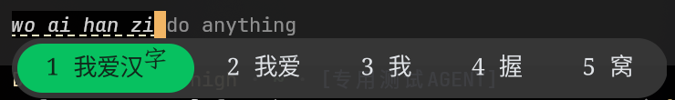

# Fcitx5 capsule themes



Three compact, translucent dark themes designed by **zxzx** for Fcitx5 Classic UI.
They share a capsule-shaped panel and candidate highlight, with coordinated
colors for the candidate list and menu.

| Theme | Accent |
| --- | --- |
| `WeChatGreen[zxzx]` | Green |
| `DustyRose[zxzx]` | Muted rose |
| `GraphiteSilver[zxzx]` | Neutral silver |

The current design uses pill-shaped SVG assets, compact vertical spacing,
translucent panel fills, and an explicit blur mask. Geometry and margins have
been redesigned for this collection; it is not presented as a macOS-dark
color variant.

## Install

Clone the repository, then copy the theme directories into Fcitx5's user theme
directory:

```sh
git clone https://github.com/zxzxn3/fcitx5-themes.git
mkdir -p ~/.local/share/fcitx5/themes
cp -R 'fcitx5-themes/WeChatGreen[zxzx]' ~/.local/share/fcitx5/themes/
cp -R 'fcitx5-themes/DustyRose[zxzx]' ~/.local/share/fcitx5/themes/
cp -R 'fcitx5-themes/GraphiteSilver[zxzx]' ~/.local/share/fcitx5/themes/
```

Select a theme in the Classic User Interface settings of `fcitx5-configtool`,
then apply the settings. The equivalent theme selection in
`~/.config/fcitx5/conf/classicui.conf` is:

```ini
Theme=WeChatGreen[zxzx]
DarkTheme=WeChatGreen[zxzx]
```

Replace both names to select another variant. These are Classic UI themes;
other Fcitx5 frontends may render their own candidate panels.

## Appearance

The geometry was tuned with Noto Fangsong KSS Rotated at size 13 and 96 DPI.
Other fonts and display scales can change the result. Blur depends on the
desktop compositor; the themes request it but cannot guarantee its availability.

Colors and margins are defined in each `theme.conf`. The SVG files define the
panel, highlight, and blur-mask shapes. No installer or background service is
included.
